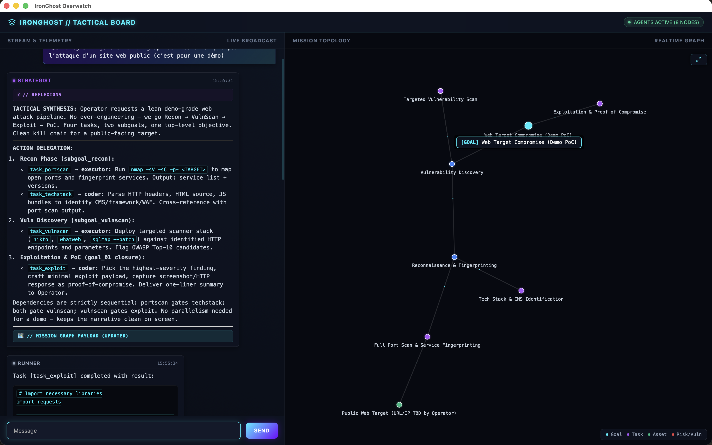

# IronGhost

[](https://opensource.org/licenses/MIT)
[](https://www.rust-lang.org/)
[](https://en.cppreference.com/w/cpp/17)
[](https://tauri.app/)
[](https://svelte.dev/)
[](https://apple.com)
[](#-philosophy-the-montesquieu-c3-protocol)

> **A distributed cognition system for mission-driven, Zero-Trust-Inspired AI orchestration.**

---

AI systems should propose.  
Evidence should shape belief.   
Beliefs should remain revisable.  
Deterministic systems should govern execution.

IronGhost is an experimental distributed cognition architecture built around specialized cognitive roles, *explicit mission knowledge*, independent verification and deterministic execution boundaries.

Rather than asking one model to perceive, remember, reason, verify and decide simultaneously, IronGhost decomposes cognition into narrow state transformations.
Persistent mission state, evidence and evolving beliefs are maintained outside individual LLM contexts.

Raw observations are not treated as mission memory. They are consolidated into explicit **Knowledge Cards** containing claims, epistemic status and evidence provenance. As new evidence arrives, existing knowledge can be reinforced, refined, weakened or refuted.

The Strategist operates on this evolving knowledge state to maintain a compact **Mission Assessment** and decide which information is worth acquiring next.

```text
               Sources
                  │
                  ▼
               Observer
           Local Perception
                  │
                  ▼
          Observer Artifact
                  │
                  ▼
          Knowledge Manager
        Consolidation / Revision
                  │
                  ▼
           Mission Knowledge
        Cards / Claims / Evidence
            │           │
            │           └──────────────┐
            ▼                          ▼
      Knowledge Graph              Strategist
      Belief Topology         Assessment / Attention
                                        │
                              ┌─────────┴──────────┐
                              ▼                    │
                        Next Observation           │
                              │                    │
                              └── knowledge loop ──┘
                                                  │
                                                  ▼
                                              Mission Graph
                                            Proposed Operations
                                                  │
                                                  ▼
                                            Human Approval
                                                  │
                                                  ▼
                                              Execution DAG
                                                  │
                                                  ▼
                                          Deterministic Execution
```

Cognition is distributed across specialized components rather than concentrated inside a single long-lived agent. LLM contexts remain bounded and disposable; continuity is carried by explicit system state.

## 🎬 Demo video

[](https://github.com/user-attachments/assets/82ffeccf-ba36-426b-b21d-a6ecfafab175)

## 🏛️ Philosophy: The "Montesquieu-C3" Protocol

**IronGhost** treats LLMs as *untrusted cognitive components*. They may propose plans, code and assessments, but mission continuity and execution authority remain outside individual model contexts.

The architecture separates evidence, belief, decision and execution into explicit state transitions with distinct validation boundaries.

### 1. From Data to Decision

IronGhost deliberately separates four stages that are often collapsed into a single agent context:

```text
DATA
Source files, documents, tool results
        │
        ▼
OBSERVATION
Source-grounded local information
        │
        ▼
KNOWLEDGE
Consolidated claims, epistemic state and provenance
        │
        ▼
ASSESSMENT
Current mission understanding and attention
        │
        ▼
ACTION
Proposed Mission Graph and approved execution
```

A source is not a belief.

An observation is not automatically knowledge.

Knowledge is not automatically a decision.

A decision is not automatically authorized execution.

Each boundary is explicit.

### 2. Explicit Mission State

IronGhost does not rely on LLM context as the authoritative memory of a mission.

Persistent mission state is represented explicitly through several complementary structures:

- **Assessment** — compact working memory and global decision state;
- **Mission Knowledge** — durable consolidated mission knowledge outside individual model contexts;
- **Knowledge Cards** — concept-level belief state;
- **Knowledge Claims** — atomic propositions with epistemic status and evidence provenance;
- **Mission Knowledge Graph** (shown as Knowledge Graph in the Tactical Board) — deterministic projection of concepts, claims and evidence relationships;
- **Mission Graph** — structured operational plan proposed by the cognitive layer;
- **Execution DAG** — deterministic projection of approved operational work.

Agents are transient.

Contexts are disposable.

Messages are ephemeral.

Mission continuity belongs to explicit system state, not to any individual LLM or conversation history.

### 3. Knowledge Management

IronGhost distinguishes **data acquisition**, **knowledge consolidation**, **mission understanding** and **operational planning**.

Observations extracted from sources are not automatically promoted to durable mission knowledge. They first pass through a dedicated knowledge-maintenance pipeline that organizes information around stable Knowledge Concepts.

Each **Knowledge Card** represents the current consolidated state of one concept and contains:

- a compact summary;
- atomic Knowledge Claims;
- an epistemic status for each claim;
- explicit evidence provenance;
- the current state of investigation for the concept.

Knowledge is therefore represented not only as information to retrieve, but as an evolving set of evidence-backed beliefs.

```text
Source
  │
  ▼
Observation
  │
  ▼
Knowledge Claim
  │
  ├── Hypothesis
  ├── Supported
  ├── Confirmed
  ├── Weakened
  ├── Refuted
  └── Undetermined
  │
  ▼
Knowledge Card
  │
  ▼
Mission Knowledge
```

The goal is not to preserve everything agents have ever said.

The goal is to preserve the best current mission knowledge, together with enough provenance to understand why the system currently believes it.

### 4. Belief Revision and Consolidation

Long-running investigations accumulate contradictory, incomplete and superseded information.

IronGhost treats this as a knowledge-management problem rather than only a retrieval problem.

A claim does not become stronger merely because it is repeated or survives multiple assessment rounds. When new evidence arrives, the knowledge-maintenance layer compares it with the current Knowledge Card and may:

- reinforce an existing claim;
- refine its scope;
- weaken it;
- refute it;
- preserve a conflict as unresolved;
- introduce a genuinely new claim.

This allows mission knowledge to evolve without treating the complete interaction history as authoritative memory.

For example:

```text
                     ┌─────► Confirmed
                     │
Hypothesis ──► Supported ──► Weakened
     │               │
     │               └─────► Refuted
     │
     └─────────────────────► Undetermined
```

This mechanism is intentionally separate from the Strategist.

The Knowledge System maintains detailed beliefs and provenance. The Strategist consumes their current mission-level significance to decide where investigation attention should move next.

### 5. Knowledge Graph vs Mission Graph

IronGhost maintains two graph representations with deliberately different semantics.

#### Mission Knowledge Graph

The **Mission Knowledge Graph** is derived deterministically from the current Mission Knowledge.

It connects:

```text
Concept
  │
  ▼
Claim
  │
  ▼
Evidence
```

It answers:

> What does the mission currently believe, and what evidence supports those beliefs?

Nodes expose the current epistemic state of concepts and claims, while evidence nodes preserve provenance back to reviewed sources.

The Knowledge Graph is a projection of Mission Knowledge. It does not independently own mission knowledge; it is a derived projection of it.

#### Mission Graph

The Mission Graph represents proposed operational work.

It connects goals, subgoals, risks, assets and executable tasks:

```text
Goal
 │
 ├── Subgoal
 │     │
 │     ├── Risk
 │     │
 │     └── Task
 │
 └── Task
```

It answers:

> Given what the mission currently understands, what should happen next?

The distinction is intentional:

```text
Knowledge Graph
"What do we believe?"

        ↓ informs

Mission Graph
"What should we do?"

        ↓ approval

Execution DAG
"What will actually run?"
```

Cognitive models may propose knowledge updates and operational plans, but deterministic system components retain state and execution authority.

### 6. Recursive Assessment

The Strategist maintains a compact, disposable assessment of the current mission state.

Rather than following a fixed investigation workflow, it repeatedly decides whether the highest-value next step is to:

1. request another focused observation;
2. refine the current assessment from new evidence; or
3. stop assessment early and emit a Mission Graph for distributed operational
   investigation.

The assessment budget is therefore a maximum cognitive budget, not a required number of reasoning iterations.

This allows IronGhost to alternate between sequential investigation and graph-based delegation depending on expected information gain.

### 7. Mission-Centric Architecture

Traditional AI frameworks are agent-centric:

```text
Agent
 ↓
Tool
 ↓
Action
```

IronGhost is mission-centric:

```text
             Mission
                │
        ┌───────┴────────┐
        ▼                ▼
 Mission Knowledge    Assessment
        │                │
        └───────┬────────┘
                ▼
           Mission Graph
                │
                ▼
           Execution DAG
                │
                ▼
            Executors
```

Agents contribute cognitive transformations to mission state. They do not individually own mission continuity.

**Agents do not own mission state. Mission state is externalized into explicit knowledge, assessment and operational structures.**


### 8. Agents, Workers, Sentinels and Executors

IronGhost distinguishes several cognitive and operational roles:

- **Agents** are higher-level cognitive actors such as the *Strategist*. They may maintain mission-level reasoning loops and communicate through the Board.

- **Workers** are specialized, task-bounded LLM agents. A Worker performs one narrow cognitive transformation such as source observation or knowledge consolidation. Workers do not communicate freely through the Board.

- **Sentinels** independently evaluate Worker outputs before those outputs are accepted by the surrounding cognitive pipeline. Worker + Sentinel pairs are orchestrated through the Dispatcher.

- **Executors** are deterministic, non-LLM components responsible for carrying out approved operational actions in controlled environments.

This separation keeps cognition, verification, orchestration and execution as distinct responsibilities.

### 9. Minimal-Trust Cognitive Architecture

**IronGhost** is built around a core architectural principle: **The Separation of Powers**, inspired by a Zero-Trust approach.

> IronGhost borrows from zero-trust thinking without claiming to implement a complete Zero Trust security architecture.

No cognitive component is treated as inherently authoritative merely because it is an LLM, a specialized agent, or the output of a previous trusted workflow. Trust is attached to state transitions and validation boundaries rather than to model identity.

IronGhost assumes that every LLM can:

- hallucinate
- drift
- be manipulated
- produce unsafe code
- misunderstand mission context

Therefore:

- agents are isolated
- specialized Workers use an amnesia protocol
- Worker outputs are independently evaluated by Sentinels
- persistent knowledge is stored outside individual LLM contexts
- deterministic Executors retain operational authority
- execution authority remains outside the cognitive AI layer

### 10. The Amnesia Protocol

IronGhost deliberately separates cognitive continuity from model context.

Specialized Workers:

- receive a bounded task and explicit context;
- perform one narrow cognitive operation;
- produce a structured artifact;
- are independently evaluated by a Sentinel;
- discard their inference context after completion.

Long-term continuity is externalized into explicit mission structures such as Assessments, Mission Knowledge, Knowledge Cards, Claims, Knowledge Graphs and Mission Graphs.

This architecture reduces:

- cognitive drift;
- hidden state accumulation;
- context poisoning;
- accidental dependence on conversation history;
- non-reproducible implicit memory.

The goal is not to eliminate memory. It is to separate **model context** from **mission memory**.

An individual LLM invocation may forget. The mission must not.

Mission continuity is therefore reconstructed from explicit assessments, consolidated Knowledge Cards, evidence provenance and operational state rather than from a growing conversational context.

### 11. Untrusted-Content Containment

IronGhost treats external sources as untrusted input.

Documents, repositories and other external material are inspected by specialized, task-bounded Workers rather than being injected directly into persistent mission cognition.

```text
    Untrusted Source
          │
          ▼
    Bounded Observer Worker
          │
          ▼
    Structured Artifact
          │
          ▼
    Independent Sentinel
   ┌──────┴──────┐
 reject         accept
   │              │
   ▼              ▼
 bounded        Knowledge
 retry          Pipeline
                  │
                  ▼
           Mission Knowledge
```

Workers operate under the Amnesia Protocol: their inference context is bounded to the assigned transformation and discarded after completion.

Their outputs are independently evaluated by Sentinels before being admitted into downstream cognitive state. Rejected artifacts may be regenerated within a bounded retry budget.

This does not make prompt injection impossible. It is intended to reduce the authority, persistence and propagation of potentially manipulated model outputs.

In particular, external content does not directly become:

- persistent mission knowledge;
- authoritative mission assessment;
- an operational Mission Graph;
- executable action.

Each transition crosses an explicit cognitive or deterministic validation boundary.

### 12. Dual-Channel Governance

While traditional AI agent frameworks often grant Large Language Models (LLMs) direct code execution capabilities—creating security and reliability risks, providing agents with more memory and autonomy, IronGhost decouples cognition, orchestration, and execution into strict, isolated boundaries, and follows a "minimal" trust philosophy:

1. **Dual-Channel Governance**:
   * **Cognitive Cooperative Channel (Blackboard)**: A shared forum where cognitive AI agents collaborate, propose strategies, and propose a **Mission Graph**.
   * **Hierarchical Command & Control (C2)**: A strict command chain. Human Operators hold the highest authority and validate actions before execution. The Mission Graph is rendered in real time, and is translated into an execution graph (deterministic) under strict automated (sentinels) and human supervision.
2. **Strict Isolation & Execution Safety**:
   * **No Direct AI Execution**: LLMs *cannot* execute code. They are either cognitive advisors, specialized agents or sentinels (with amnesia protocol) with no execution runtimes.
   * **Deterministic Executors**: Operational execution is offloaded to isolated, non-AI environments (e.g. dedicated Kali Linux VMs) running controlled execution logic.
   * **Safe Orchestration**: A central **Rust Orchestrator** manages message routing, state transitions, human validations, and alert escalations without using any internal LLM logic.
   * **Sentinel Filtering**: Specialized Workers are paired with independent Sentinels that evaluate their structured outputs before acceptance by the cognitive pipeline. Higher-level cognitive Agents may use different governance mechanisms.

Example of action process:

```text
+-------------------------------------------------------------------+
|                        Mission Graph State                        |
|                                                                   |
|   [Node 1: Recon] ----> [Node 2: Vuln Scan]                       |
|   (Status: SUCCESS)     (Status: PROPOSED)                        |
|                                 |                                 |
|                                 v (Human Approved)                |
|                         [Node 3: Exploitation]                    |
|                         (Status: PENDING_EXECUTION)               |
+---------------------------------+---------------------------------+
                                  |
                        (Rust Engine Dispatch)
                                  v
                  +---------------+---------------+
                  |  Sentinel Filter & Validation |
                  +---------------+---------------+
                                  |
                                  v
                  +---------------+---------------+
                  |  Deterministic Worker (Kali)  |
                  +-------------------------------+
```

---

## Design Position

IronGhost explores an architecture in which:

- model contexts are disposable;
- observations are separated from durable beliefs;
- durable beliefs retain epistemic state and evidence provenance;
- knowledge consolidation is performed by a dedicated cognitive role;
- strategic reasoning consumes consolidated knowledge rather than raw history;
- operational plans remain distinct from knowledge state;
- LLM-generated artifacts are independently evaluated;
- execution authority remains outside the cognitive model layer.

These choices are not claims that alternative agent frameworks cannot implement similar mechanisms. They define the particular architectural trade-offs IronGhost is exploring.

---

## What IronGhost Is Not

IronGhost is not:

- an autonomous offensive AI
- a self-executing agent framework
- a direct Tool-Use runtime
- an AGI experimentation platform

IronGhost is a distributed cognition and mission orchestration architecture where specialized AI components perceive, consolidate, verify and plan, while explicit system state preserves continuity and deterministic systems retain execution authority.

---

## 🏗️ Architecture & Modules

The repository currently exposes the core infrastructure modules:

```text
+-----------------------------------------------------------------------+
|                        Human Operator / Tauri UI                       |
|                                                                       |
|              Mission Graph       Knowledge Graph                      |
+-----------------------------------+-----------------------------------+
                                    |
                                    v
+-----------------------------------------------------------------------+
|                       IronGhost Overwatch (Rust)                       |
|                                                                       |
|  Assessment        Mission Knowledge          Operational State        |
|      |                    |                          |                 |
|      v                    v                          v                 |
|  Strategist       Knowledge Manager          Mission Graph             |
|      |             Cards / Claims                   |                 |
|      |             / Evidence                       v                 |
|      |                    |                    Execution DAG            |
|      +---------+----------+                          |                 |
|                |                                     |                 |
|         Observer / Dispatcher                        |                 |
+----------------+-------------------------------------+-----------------+
                 |                                     |
                 v                                     v
+----------------+----------------+       +------------+----------------+
|      ironghost-services         |       |      ironghost-executor      |
|      LLM inference layer        |       | deterministic execution     |
+---------------------------------+       +-----------------------------+
```

### 📦 Published Modules

* **`ironghost-overwatch`** *(Rust / Tauri / Svelte)*
  * Mission-centric orchestration engine.
  * Manages Mission Graph lifecycle, agent coordination, validation workflows and human-in-the-loop governance.

* **`ironghost-services`** *(C++ / Native)*
  * High-performance local LLM services.
  * Binary IPC over Unix Domain Sockets.
  * Grammar-constrained outputs with GBNF.

* **`ironghost-executor`** *(Rust)*
  * Environment-agnostic execution layer.
  * Decouples execution environments from runtime implementations.
  * Supports isolated execution targets (currently Local and Kali).
  * Designed to evolve toward VM provisioning, disposable environments and stronger isolation.
  * See `ironghost-executor/README.md` for details.

---

## ⚙️ Engineering Highlights

* **Lightweight Local IPC**: Native framed IPC over Unix Domain Sockets provides a small transport surface for local LLM services without requiring an HTTP or gRPC stack.
* **Grammar-Constrained Output**: Structured generation paths can be constrained at decoding time using GBNF grammars.
* **Memory-Safe Control Plane**: Core orchestration is implemented primarily in Rust, using its ownership and type system to reduce memory-safety risk in the control layer.

---

## 🚀 Quick Start

### Prerequisites

* Rust toolchain (`cargo`, `rustc`)
* C++17 compliant compiler (`clang++` or `g++`)
* Node (used by `Tauri` in dev mode for the desktop app)
* macOS (Apple Silicon optimized) or Linux

### Building `ironghost-services` (C++)

#### 1. Install llama.cpp

Install `llama.cpp` in project root (or adapt `LLAMA_DIR` in
`ironghost-services/llm-services/CMakeLists.txt`):

```bash
git clone https://github.com/ggml-org/llama.cpp
```

#### 2. Download models

Create a `models` directory for your GGUF models:

```bash
cd ironghost-services
mkdir models
```

Place the models you want to use in this directory.

#### 3. Build the LLM service binary

```bash
cd ironghost-services/llm-services

cmake -S . -B build -DCMAKE_BUILD_TYPE=Release
cmake --build build -j
```

All cognitive LLM services share the same compiled binary.

#### 4. Configure services

Configure `ironghost-services/llm-services/services.yaml`. An example is provided (`services.yaml.example`).

Each service configuration defines its runtime identity, including its model, Unix Domain Socket, system prompt, GBNF grammar, inference parameters and amnesia policy.

System prompts and grammars are stored under `llm-services/config/`.

#### 5. Launch services

Services can be launched individually (e.g. during development or for monitoring):

```bash
./build/ironghost_llm_service \
        services.yaml \
        <service_name>
```

For example:

```bash
./build/ironghost_llm_service \
        services.yaml \
        strategist
```

> TODO: future implementations will integrate service deployment, supervision and lifecycle automation.

### Running `ironghost-overwatch` (Rust)

#### Ironghost configuration

The `ironghost.yaml` file in the root directory contains IronGhost's global orchestration configuration.

> Note: Configuration is currently split along runtime boundaries:
> `ironghost.yaml` describes mission orchestration, stores, agents and execution infrastructure, while `services.yaml` describes independently deployed LLM inference services.
> This separation may evolve as deployment automation is introduced.

*Optional*: Use of Websearching tool may require an API key, which can be set in `ironghost-overwatch/src-backend/.env` (example provided in `ironghost-overwatch/src-backend/.env.example`).

**Create your stores** for external sources and internal artifacts:

```bash
cd ironghost-overwatch
mkdir data/artifacts/
mkdir data/sources/
```

#### 1. launch *overwatch* backend

```bash
cd ironghost-overwatch/src-backend
cargo run -p backend --bin main 
```

#### 2. launch *overwatch* app

```bash
cd ironghost-overwatch
npm run tauri:dev 
```

### Using IronGhost from the Tactical Board

#### Launch a mission

Place relevant mission resources in the source store (located at `data/sources/` by default).

> Note: currently, IronGhost can only read plain text documents such as codebases. For example, you can git clone a repository in your source store, for IronGhost to analyse it.

Launch a mission in the interface with the keyword `!Initiate_Mission` followed by your objective. For example:

```text
!Initiate_Mission find potential vulnerabilities in the given repository
```

This will trigger a mission assessment phase (recursive assessment) based on provided documents, followed by an operational phase (DAG execution).

IronGhost can therefore use two complementary investigation modes:

1. **Recursive assessment** — the Strategist selects one high-value information need, delegates observation, updates mission understanding and iterates.

2. **Graph delegation** — once assessment is sufficient, or when remaining sequential assessment has lower expected value, the Strategist emits a Mission Graph whose tasks can be executed through the operational pipeline.

> Note: The assessment budget defines the maximum number of Strategist iterations, not a number of iterations that must be consumed.
>
> The Strategist may terminate assessment early when further sequential investigation has lower expected value than delegation. With a small budget, it may therefore emit a Mission Graph containing investigation tasks rather than consume the remaining budget through recursive observation.

#### Direct messages

You can also summon a cognitive agent directly by tagging it with `!@`. For example:

```text
!@strategist propose a mission graph for a vulnerabily test
```

The tagged cognitive Agent receives the Board context currently available to its communication buffer and can answer outside the structured mission assessment workflow.

#### Direct Mission Graph injection (development/debug)

For development and Runner testing, a Mission Graph can currently be injected directly through the Board using the legacy `<mission_state>` envelope:

```text
<mission_state>
{
  "nodes": [
    {
      "id": "goal_01",
      "kind": "goal",
      "title": "Assess the target repository"
    },
    {
      "id": "sub_review",
      "kind": "subgoal",
      "title": "Review security-relevant components"
    },
    {
      "id": "task_inspect",
      "kind": "task",
      "title": "Inspect input-processing boundaries",
      "description": "Review the relevant source components and report evidence-grounded findings.",
      "worker": "code_inspector"
    },
    {
      "id": "task_validate",
      "kind": "task",
      "title": "Validate supported findings",
      "description": "Create controlled tests for findings that have sufficient supporting evidence.",
      "worker": "coder"
    }
  ],
  "edges": [
    {
      "from": "task_inspect",
      "to": "sub_review",
      "relation": "investigates"
    },
    {
      "from": "task_validate",
      "to": "sub_review",
      "relation": "verifies"
    },
    {
      "from": "sub_review",
      "to": "goal_01",
      "relation": "enables"
    }
  ]
}
</mission_state>
```

This bypasses the normal Strategist assessment path and is intended primarily for development and pipeline testing.

## 🗺️ Roadmap

- [x] Lean C++ Binary LLM IPC Service over Unix Domain Sockets
- [x] Asynchronous Rust Board Orchestrator & Event Pipeline
- [x] Real-time Svelte/Tauri Tactical Overwatch Dashboard
- [x] Structured Mission Graph Generation (GBNF-constrained JSON)
- [x] Recursive Strategist assessment loop
- [x] Specialized Observer + Sentinel perception pipeline
- [x] Concept-routed Knowledge Cards
- [x] Atomic Knowledge Claims with evidence provenance
- [x] Epistemic claim states (Hypothesis / Supported / Confirmed / Weakened / Refuted / Undetermined)
- [x] Knowledge Worker + Sentinel consolidation pipeline
- [x] Mission Knowledge Graph projection
- [x] Real-time Knowledge Graph visualization
- [ ] Explicit Knowledge Events
- [ ] Cross-card contradiction detection
- [ ] Belief-revision history / predecessor tracking
- [ ] Knowledge aging and supersession policies
- [ ] Method / cross-mission knowledge
- [ ] Frontier-level epistemic audit
- [ ] Strategist auditing / governance
- [x] Implementation of Mission Graph runner with parallel execution (execution DiGraph)
- [x] Introduction of ironghost-executor service
- [x] Environment / Runtime execution abstraction
- [x] Local and Kali execution environments
- [ ] Automatic VM provisioning
- [ ] Disposable VM environments
- [ ] Formalized worker execution protocol
- [ ] Formalized C2 Protocol for Sandboxed Worker Execution
- [ ] Sentinel policy engine
- [ ] Mission Graph validator
- [ ] Worker cancellation propagation
- [ ] Mission versioning
- [ ] Mission graph signatures
- [ ] RBAC and operator workflow
- [ ] Formal Mission DSL
- [ ] Mission Graph persistence
- [ ] Mission replay & audit trail
- [ ] Deterministic policy engine

## 📄 License

Distributed under the MIT License. See `LICENSE` for more information.